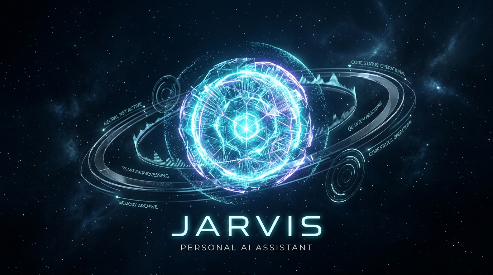
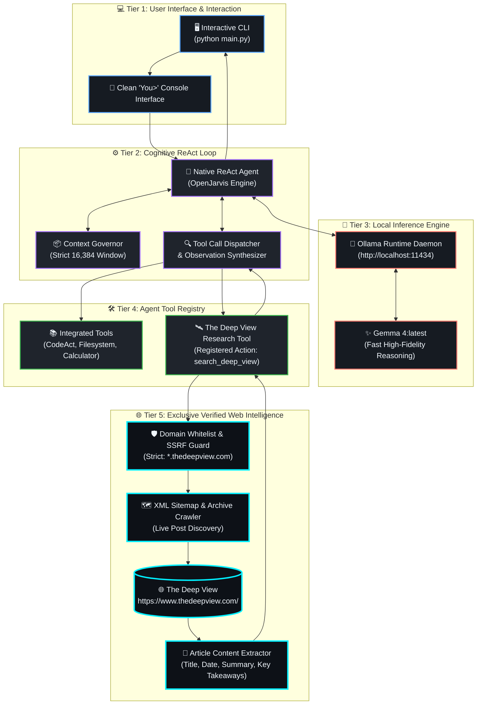
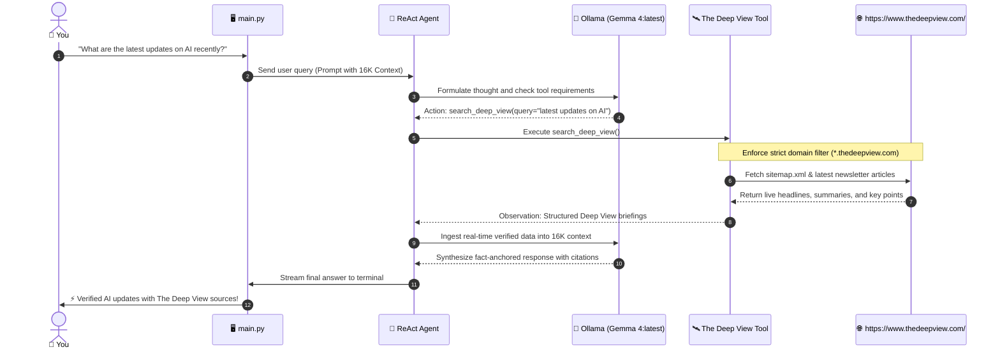

<div align="center">



# ⚡ JARVIS: Autonomous Personal AI Assistant
### *Private On-Device Intelligence &bull; Exclusive Real-Time AI News via The Deep View*

[](https://python.org)
[](https://ollama.com)
[](https://ollama.com/library/gemma4)
[-6f42c1?style=for-the-badge)](https://github.com/Xeneium/Jarvis)
[](https://www.thedeepview.com/)
[](LICENSE)

<p align="center">
  <a href="#-key-features"><b>Features</b></a> •
  <a href="#-system-architecture"><b>Architecture</b></a> •
  <a href="#-quick-start"><b>Quick Start</b></a> •
  <a href="#-the-deep-view-integration"><b>Deep View Engine</b></a> •
  <a href="#-configuration"><b>Configuration</b></a> •
  <a href="#-security--privacy"><b>Security</b></a> •
  <a href="#-license"><b>License</b></a>
</p>

---

</div>

## 🌟 Executive Overview

**JARVIS** is a production-grade, local-first autonomous personal AI assistant engineered for privacy, speed, and zero hallucination in real-time AI developments. Built to run entirely on personal hardware, Jarvis decouples everyday reasoning and web retrieval from monolithic, closed-source cloud providers.

Unlike traditional AI wrappers that indiscriminately search the web—pulling in SEO spam, advertisement farms, and unverified blogs—**Jarvis restricts all web research exclusively to [The Deep View](https://www.thedeepview.com/)**, the premier authoritative curation of artificial intelligence breakthroughs, industry benchmarks, and frontier developments.

```
       ┌────────────────────────────────────────────────────────┐
       │                  SINGLE COMMAND LAUNCH                 │
       │                   $ python main.py                     │
       └───────────────────────────┬────────────────────────────┘
                                   │
              ┌────────────────────┴────────────────────┐
              ▼                                         ▼
   ┌───────────────────────┐               ┌──────────────────────────┐
   │  100% Local Inference  │               │    Verified Intelligence │
   │   Ollama / Gemma 4    │               │ Exclusive The Deep View  │
   │      16K Context      │               │   Real-Time Newsletter   │
   └───────────────────────┘               └──────────────────────────┘
```

---

## 🚀 Key Features

| Capability | Specification | Architectural Value |
| :--- | :--- | :--- |
| **🧠 Local LLM Execution** | `Ollama` (`gemma4:latest`) | Zero data leakage; fully offline reasoning with zero cloud telemetry. |
| **⚡ 16K Optimized Context** | `16,384 tokens` | High-efficiency attention window tuned for deep multi-turn ReAct cycles and prompt responsiveness. |
| **🌐 Exclusive Retrieval** | `thedeepview.com` Only | Pinned domain whitelist. No fallback to Google, Bing, or generic web indices. |
| **🔄 Native ReAct Engine** | Thought-Action-Observation | Dynamic tool calling with multi-hop retrieval and contextual self-correction. |
| **🛡️ SSRF & Network Guard** | DNS Pinning & URL Parsing | Strict defense-in-depth preventing local host probing or unverified URL traversal. |
| **💻 Zero-Config UX** | `python main.py` | Automatic Ollama connectivity check, model fallback protection, and immediate `You>` prompt. |

---

## 🏗️ System Architecture

Jarvis employs a clean, decoupled 5-tier architecture that cleanly separates user interaction, model reasoning, agentic tool dispatch, and network-bounded retrieval.

### 3D Layered Architecture



---

### Request Execution Sequence

When you ask a question requiring contemporary AI knowledge, Jarvis dynamically triggers an iterative ReAct retrieval cycle:



---

## ⚡ Quick Start

### 1. Prerequisites
- **Operating System:** Windows, macOS, or Linux
- **Python:** `3.10`, `3.11`, or `3.12`
- **Ollama:** Installed and running locally
  ```bash
  # Ensure Ollama has pulled gemma4
  ollama pull gemma4:latest
  ```

### 2. Installation & Setup

```bash
# 1. Clone repository
git clone https://github.com/Xeneium/Jarvis.git
cd Jarvis

# 2. Create and activate a Python virtual environment
python -m venv .venv

# On Windows (PowerShell):
.venv\Scripts\Activate.ps1
# On macOS / Linux:
source .venv/bin/activate

# 3. Install dependencies
pip install -e .
```

### 3. Launch Jarvis

Run the single master command:

```bash
python main.py
```

You will immediately see the interactive console:

```text
================================================================================
  JARVIS: Autonomous Personal AI Assistant
  Model: gemma4:latest (Ollama) | Context: 16,384 tokens
  Exclusive Web Research: The Deep View (https://www.thedeepview.com/)
================================================================================

Type 'exit', 'quit', or 'q' to end the session.

You> What are the latest developments in AI foundation models?
Jarvis is thinking...
[Tool] Querying The Deep View archives...
[Tool] Retrieved latest newsletters from thedeepview.com
Jarvis> According to recent editions of The Deep View, the major focus has been...
```

---

## 🔬 The Deep View Integration

Jarvis is configured with an exclusive, tamper-proof retrieval mechanism that prevents general search engine fallbacks:

```
┌────────────────────────────────────────────────────────────────────────┐
│                        EXCLUSIVE RETRIEVAL RULES                       │
│                                                                        │
│  ✅  Permitted:   https://www.thedeepview.com/                         │
│  ✅  Permitted:   https://*.thedeepview.com/newsletters/*              │
│                                                                        │
│  ❌  BLOCKED:     Google, Bing, DuckDuckGo, Tavily, SerpAPI            │
│  ❌  BLOCKED:     Twitter / X, Reddit, Medium, Substack                │
│  ❌  BLOCKED:     Arbitrary external blogs & unvetted domains          │
└────────────────────────────────────────────────────────────────────────┘
```

### Retrieval Capabilities
1. **Dynamic Sitemap Discovery:** Automatically inspects The Deep View's live XML sitemaps to locate new issues within seconds of publication.
2. **Key Takeaway Parser:** Extracts core breakthroughs, model releases, benchmark scores, and executive summaries while stripping ads and tracker scripts.
3. **Transparent Citations:** Every real-time response provides article dates, headlines, and original URLs from `thedeepview.com`.

---

## ⚙️ Configuration & Environment

Configuration is governed by environment variables and sensible production defaults. Copy the template to customize:

```bash
cp .env.example .env
```

| Variable | Default Value | Description |
| :--- | :--- | :--- |
| `OLLAMA_BASE_URL` | `http://localhost:11434` | Endpoint for the local Ollama daemon. |
| `OLLAMA_MODEL` | `gemma4:latest` | Target local model. Preserved by default. |
| `OLLAMA_NUM_CTX` | `16384` | Sets context window length to 16K tokens. |
| `DEEP_VIEW_MAX_RESULTS` | `5` | Maximum number of newsletter articles fetched per search. |
| `DEEP_VIEW_REQUEST_TIMEOUT` | `15` | Request timeout in seconds for deepview queries. |

---

## 🛡️ Security & Privacy Architecture

Jarvis is designed from first principles with a zero-trust local-first security posture:

- **Strict Network Boundary:** The agent cannot initiate arbitrary outbound connections to external search engines or untrusted domains.
- **SSRF Protection:** URL validation enforces strict host checking against `thedeepview.com`, preventing intranet or loopback exploitation.
- **Zero Cloud Telemetry:** Inference runs 100% on localhost via Ollama. No user prompts, chat histories, or trace logs are transmitted to external servers.
- **Clean Repo History:** Sanitized of binary bloat and foreign commit histories.

---

## 📂 Repository Structure

```text
Jarvis/
├── main.py                     # Single-command CLI entrypoint with ReAct orchestration
├── pyproject.toml              # Project metadata & dependency specifications
├── .gitignore                  # Production Git ignore rules (binaries & secrets filtered)
├── assets/
│   ├── jarvis_hero_banner.png  # 3D Futuristic HUD Hero Banner
│   └── OpenJarvis_Circular_Logo.png
├── src/
│   └── openjarvis/
│       ├── agents/             # Native ReAct, CodeAct, and conversational agents
│       ├── tools/
│       │   └── deep_view.py    # Exclusive The Deep View retrieval engine & parser
│       ├── models/             # Ollama client with 16K context window enforcement
│       └── core/               # Context governors, tool registries, and execution loops
└── tests/
    └── test_deep_view.py       # Comprehensive verification suite for Deep View tools
```

---

## 🧪 Verification & Testing

Run the automated verification suite to validate tool execution, domain filters, and context management:

```bash
# Run Deep View retrieval & security tests
pytest tests/test_deep_view.py -v
```

---

## 📄 License

This project is licensed under the [Apache License 2.0](LICENSE).

---

<div align="center">
  <b>⚡ JARVIS &bull; Built with pride for autonomous, private, and factual AI.</b>
</div>
